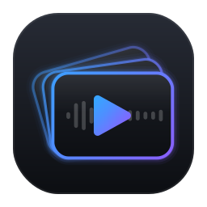
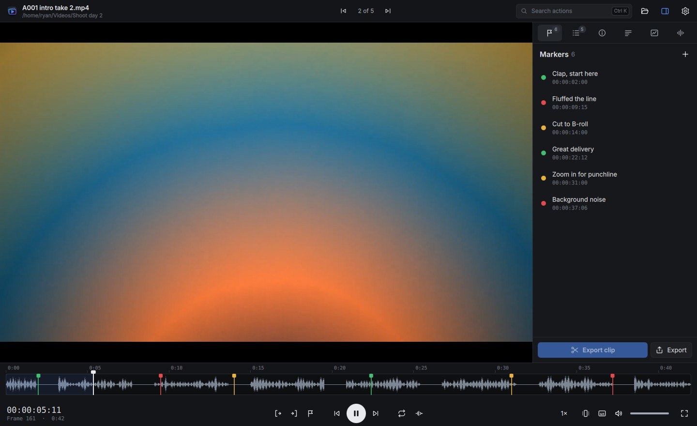
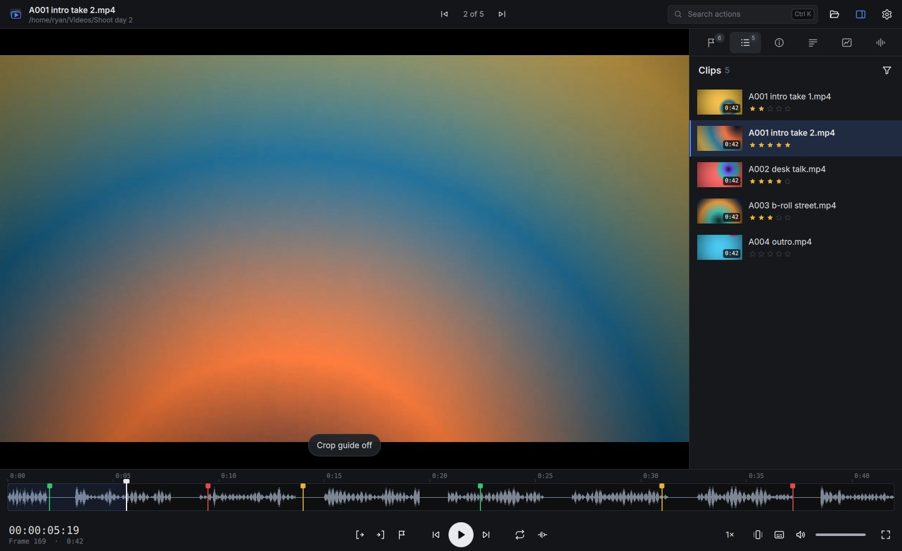
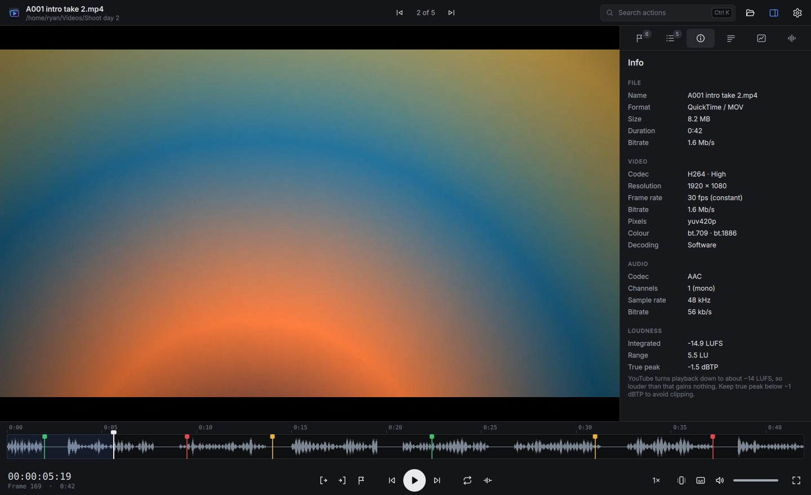
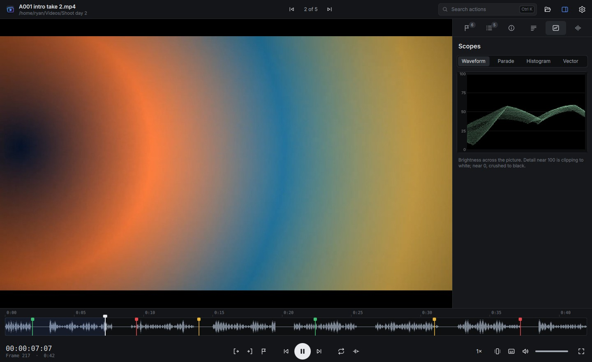
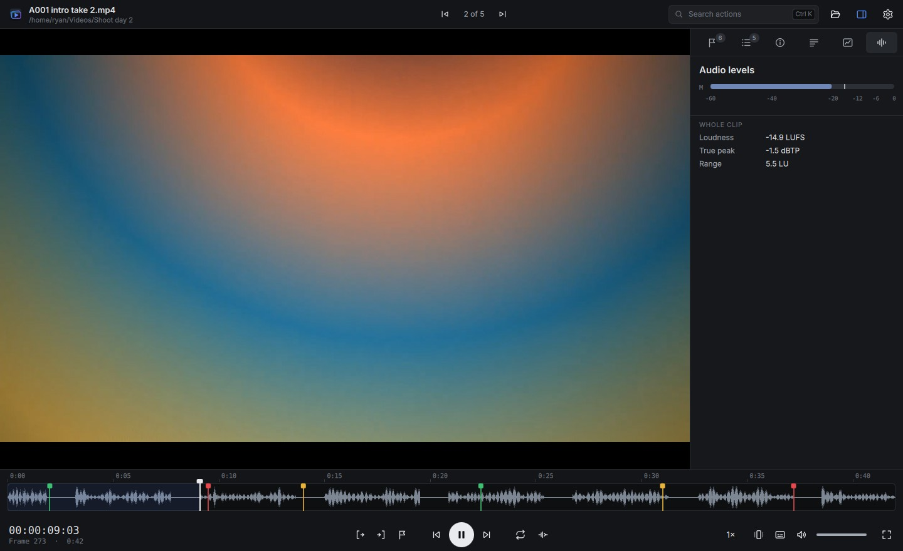
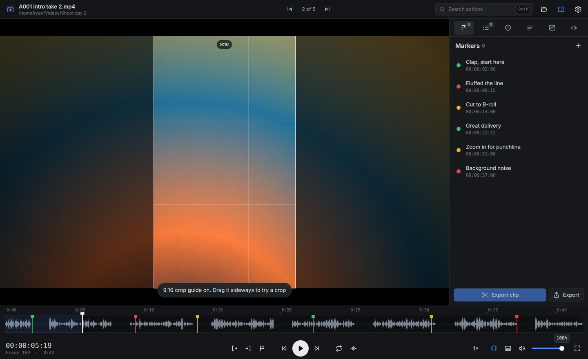
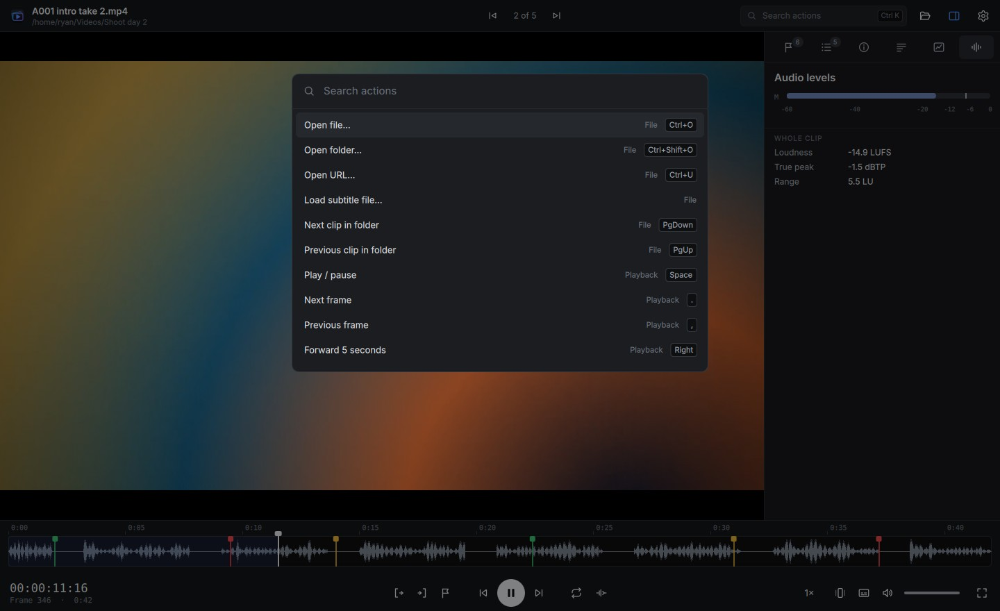
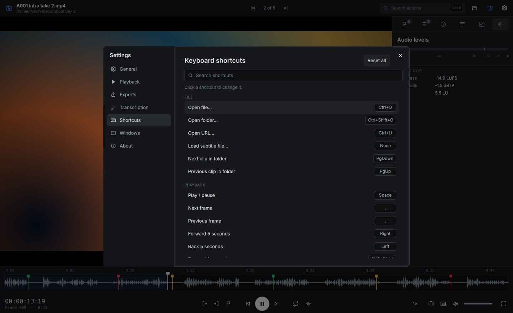
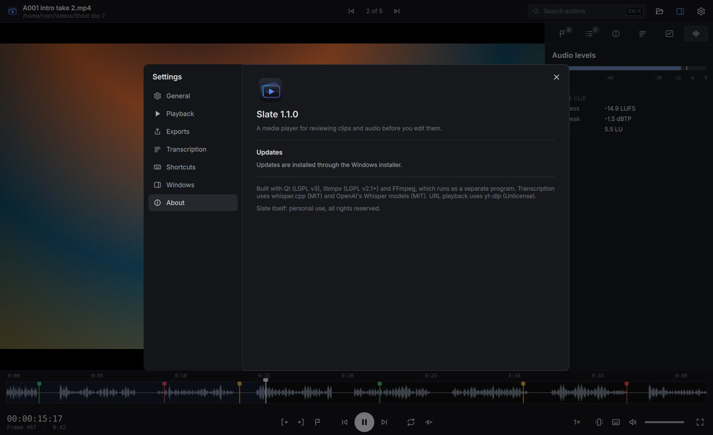

<p align="center">
  
</p>

<h1 align="center">Slate</h1>

<p align="center">
  <b>A fast media player for reviewing footage before you edit it.</b><br>
  Plays almost anything, and adds the tools a YouTube editor actually reaches for:<br>
  frame stepping, markers that drop straight into DaVinci Resolve, lossless clip cutting and loudness metering.
</p>

<p align="center">
  <a href="https://github.com/Aztr1xX/Media-Player/releases/latest/download/Slate-Setup.exe"></a>
</p>

<p align="center">
  <a href="https://github.com/Aztr1xX/Media-Player/releases/latest"></a>
  <a href="https://github.com/Aztr1xX/Media-Player/actions/workflows/windows.yml"></a>
  
  
</p>

<p align="center">
  
</p>

---

## Contents

- [Why Slate](#why-slate)
- [Features](#features)
- [Screenshots](#screenshots)
- [Install](#install)
- [A typical review session](#a-typical-review-session)
- [Keyboard shortcuts](#keyboard-shortcuts)
- [Using markers in DaVinci Resolve](#using-markers-in-davinci-resolve)
- [Build from source](#build-from-source)
- [How it is built](#how-it-is-built)
- [Troubleshooting](#troubleshooting)
- [Licence](#licence)

## Why Slate

Before editing a video you usually sit through every raw clip once: finding the good takes, noting
mistakes, checking the audio and pulling out the bits worth keeping. A normal media player can play the
files but forgets everything you noticed. An editor can do it all, but it is slow to open and makes you
import everything first.

Slate sits in between. Open a file or a whole folder from Explorer, step through it frame by frame,
drop markers as you go, rate each take, cut out the part you need without re-encoding, then send the
markers to DaVinci Resolve. It is built on **libmpv** (the engine behind mpv) with **FFmpeg** for analysis,
so it opens practically any video or audio format, and uses a modern **Qt 6** interface.

## Features

### Playback
- Plays video, audio and URLs (through yt-dlp), with hardware decoding where it is reliable.
- Drop a file or a folder. A folder becomes the clip list, in natural order (clip 2 before clip 10).
- **J / K / L** shuttle, 0.25× to 4× speed with pitch kept, and **skip silences** while playing.
- Resumes long files where you left off, and reuses the open window when you open another file from Explorer.
- Media keys work, and your own `mpv.conf` and scripts are picked up.

### Reviewing
- **Frame accurate**: step frames both ways, SMPTE timecode and frame number, exact seeks on release.
- **Timeline** with the audio waveform, In / Out range, markers and a hover preview of the frame.
  Ctrl + wheel zooms around the pointer, double-click resets.
- **Markers** in three kinds (Note, Good take, Mistake) with notes, saved automatically for each file.
- **Clips panel** with thumbnails, durations and 1 to 5 star ratings, plus a rating filter.
  Right-click a clip to **compare it side by side** with the current one.
- **Crop guide** (G): a 9:16, 4:5 or 1:1 frame over the picture, draggable sideways, to see if a shot works as a Short.
- **Picture zoom**: Ctrl + scroll zooms at the pointer, drag to pan, Z toggles 200% and fit.

### Analysis
- **Media info**: codec, resolution, real frame rate (it flags variable frame rate, which causes audio
  drift in editors), colour and HDR, bitrate, and loudness in LUFS compared with YouTube's −14 LUFS.
- **Video scopes**: luma waveform, RGB parade, histogram and vectorscope, drawn off the UI thread so playback stays smooth.
- **Audio levels**: a live left and right peak meter and the whole clip's loudness, true peak and range.
  Listen to the left or right channel alone to check each mic.
- **Transcript**: runs on your own computer with whisper.cpp (it downloads a speech model the first time).
  Click a line to jump there, search it, or save it as SRT subtitles or plain text.

### Exporting
- **Cut In to Out** losslessly (instant, no quality loss) or frame-exact (re-encoded).
- **Markers** as an EDL for DaVinci Resolve, as CSV, or copied as **YouTube chapters** (checked against YouTube's rules).
- **Current frame** saved as PNG, or copied to the clipboard with Ctrl + C to paste anywhere.
- Exports go to a `Slate exports` folder beside the clip, so they don't end up in the clip list.
  Pick a different folder in **Settings → Exports**.

### Everyday comforts
- **Command palette** (Ctrl + K) to search every action.
- **Fully remappable shortcuts** in **Settings → Shortcuts**.
- **Built-in updates**: Slate checks GitHub for a new version, downloads it in the background and installs it when you restart.
- Explorer integration: **Open with → Slate**, **Review folder in Slate** on folders, and an option to make Slate the default player.

## Screenshots

| | |
| --- | --- |
| <br>**Clips** with thumbnails and star ratings | <br>**Media info**, including loudness and variable frame rate checks |
| <br>**Scopes**: waveform, parade, histogram and vectorscope | <br>**Audio levels** with loudness, true peak and range |
| <br>**Crop guide** for checking Shorts framing | <br>**Command palette** for every action |
| <br>**Remappable shortcuts** | <br>**Updates** handled inside the app |

## Install

Slate runs on 64-bit Windows 10 and 11.

1. Download **[Slate-Setup.exe](https://github.com/Aztr1xX/Media-Player/releases/latest/download/Slate-Setup.exe)**.
2. Run it. SmartScreen warns because the app isn't code-signed: choose **More info → Run anyway**.
   Pick **Install for me only** (no admin needed) or for all users.
3. Leave **Make Slate my default video player** ticked on the last page. Windows Settings opens on
   Slate's page: press **Set default** at the top (Windows 11), or pick Slate for each file type you want.
   You can do this later from **Settings → Windows → Open Default apps**.

The installer also adds:

- a Start menu entry (and a desktop shortcut if you tick it), and an uninstaller in Settings → Apps
- **Open with → Slate** for video and audio files
- **Review folder in Slate** on the folder right-click menu (Windows 11: under "Show more options")
- `ffmpeg`, `ffprobe`, `whisper-cli` (transcription) and `yt-dlp` (URLs), so nothing else needs installing

Prefer not to install? Every release also has **Slate-portable.zip**: unzip it anywhere and run `Slate.exe`.

### Updates

A few seconds after it starts, Slate checks the [latest release](https://github.com/Aztr1xX/Media-Player/releases/latest)
and downloads anything newer in the background. When it is ready, a **Restart to update** button appears in
the top bar: Slate closes, installs the update silently and reopens. Settings, markers and ratings are kept.
Turn off automatic downloads, or check by hand, in **Settings → About**.

## A typical review session

1. Right-click the folder of raw clips in Explorer and choose **Review folder in Slate**.
2. Play the first clip. Press **M** to drop a marker whenever something happens, and pick its kind
   (Good take, Mistake or Note) in the Markers panel. Press **1** to **5** to rate the take.
3. Use **,** and **.** to find the exact frame, **I** and **O** to mark a section, and **Ctrl + E** to cut it out losslessly.
4. Check the **Info** tab for loudness and variable frame rate, and the **Audio levels** tab to make sure both mics recorded.
5. Press **PgDn** for the next clip. When you're done, filter the Clips panel by rating to see your best takes.
6. Export the markers for Resolve (below) and start editing.

## Keyboard shortcuts

These are the defaults. Every one can be changed in **Settings → Shortcuts**, and **Ctrl + K** finds any action by name.

| Key | Action |
| --- | --- |
| Space | Play / pause |
| , and . | Previous / next frame |
| ← → | Back / forward 5 s (with Shift: 1 s) |
| Home / End | Go to start / end |
| J K L | Rewind / stop / play (press L again to go faster) |
| [ ] = | Slower / faster / normal speed |
| Ctrl + Shift + K | Skip silences |
| ↑ ↓, Ctrl + M | Volume up / down, mute |
| I, O, X | Set In, set Out, clear both |
| Ctrl + L | Loop between In and Out |
| M | Add marker |
| Ctrl + ← / Ctrl + → | Previous / next marker |
| 1 to 5, 0 | Rate the clip, clear the rating |
| Ctrl + E | Export In to Out losslessly (Ctrl + Shift + E: frame-exact) |
| Ctrl + Shift + S | Save the current frame as PNG |
| Ctrl + C | Copy the current frame |
| PgUp / PgDn | Previous / next clip in the folder |
| Ctrl + O, Ctrl + Shift + O, Ctrl + U | Open file, folder, URL |
| Ctrl + = / Ctrl + - / Ctrl + 0 | Zoom the timeline in / out / show all |
| Z | Zoom the picture to 200% / back to fit |
| G | Crop guide on or off |
| Alt + 1 to 6 | Markers, clips, info, transcript, scopes, audio levels |
| H | Hide the side panel |
| F, F11 or double-click | Full screen |
| Ctrl + K | Search all actions |
| ? | Show the shortcut list |
| Ctrl + , | Settings |

## Using markers in DaVinci Resolve

1. In Slate, choose **Export → Markers for DaVinci Resolve (EDL)**.
2. In Resolve, open the clip's timeline, right-click the timeline in the Media Pool and choose
   **Timelines → Import → Timeline Markers from EDL…**, then pick the exported file.

Colours carry over (Note = yellow, Good take = green, Mistake = red), and marker notes become the marker
names. The EDL starts at 01:00:00:00 to match Resolve's default timeline start.

## Build from source

### The easy way: GitHub Actions

Every push runs [`.github/workflows/windows.yml`](.github/workflows/windows.yml), which:

1. builds Slate with Qt 6.8 and MinGW against the LGPL libmpv build,
2. runs the unit tests and an automated self-test of the packaged app on a pair of generated clips,
3. builds the installer with Inno Setup ([`packaging/windows/slate.iss`](packaging/windows/slate.iss)) and a portable zip,
4. on `main`, publishes them as a new release (version `1.1.<run number>`), which installed copies then update to.

Changes that only touch documentation (`*.md`, `docs/`) skip the workflow, so they don't push an update to everyone.

### By hand on Windows

1. Install Qt 6.8 (MinGW 64-bit) with the Qt online installer.
2. Download `mpv-dev-lgpl-x86_64-*.7z` from [zhongfly/mpv-winbuild](https://github.com/zhongfly/mpv-winbuild/releases)
   and unpack it to `deps\mpv`.
3. In a Qt MinGW terminal:

   ```bat
   cmake -S . -B build -G "MinGW Makefiles" -DCMAKE_BUILD_TYPE=Release -DMPV_DIR=%CD%\deps\mpv
   cmake --build build --parallel
   ```

4. Put `libmpv-2.dll`, `ffmpeg.exe` and `ffprobe.exe` (and optionally `whisper-cli.exe` with its DLLs, and
   `yt-dlp.exe`) next to `Slate.exe`, then run `windeployqt --qmldir qml Slate.exe`.

### On Linux (for development)

```sh
sudo apt install qt6-base-dev qt6-declarative-dev qt6-svg-dev libmpv-dev ffmpeg cmake ninja-build \
  qml6-module-qtquick-controls qml6-module-qtquick-layouts qml6-module-qtquick-dialogs \
  qml6-module-qtquick-window qml6-module-qtqml-workerscript qml6-module-qtquick-templates
cmake -S . -B build -G Ninja && cmake --build build
./build/slate_tests                        # unit tests
./build/slate --selftest some-clip.mp4     # drives the real app through the review workflow
./build/slate --tour shots/ some-clip.mp4  # saves a screenshot of every screen
```

The screenshots in this README were made with `--tour`.

## How it is built

```
src/
  mpvobject.*      the only code that talks to libmpv; renders into Qt Quick through mpv's
                   OpenGL render API and exposes playback state as properties
  media.*          background analysis with ffmpeg / ffprobe (waveform, loudness, thumbnails,
                   stream facts), cached per file
  visuals.*        waveform and scope drawing
  transcript.*     whisper.cpp transcription
  appcontroller.*  clip list, resume points, In / Out, ratings, settings, exports
  updater.*        checks GitHub releases, downloads and runs the installer silently
  markermodel.*    markers and their EDL / CSV / chapter output    } pure logic,
  timecode.*       SMPTE timecode and frame maths                  } unit tested
  folderqueue.*    natural-order clip lists                        } in tests/
  icons.*          the interface's icon set
  main.cpp         start-up, single-window handling, --selftest and --tour
qml/               the interface (Main.qml plus one file per panel and control)
assets/            app icon in SVG, PNG and ICO
packaging/windows/ installer script, icon and version resource
tests/             unit tests (Qt Test)
docs/screenshots/  images used in this README
```

## Troubleshooting

- **SmartScreen blocks the installer.** Slate isn't code-signed. Choose **More info → Run anyway**.
- **A file plays badly or not at all.** Set the environment variable `SLATE_MPV_LOG=1` and start Slate from a
  terminal to see mpv's log. Hardware decoding can be turned off in **Settings → Playback**.
- **Custom mpv settings.** Your own `mpv.conf` and scripts go in the folder shown in **Settings → Playback**.
- **Transcription does nothing.** The first run downloads a speech model, so it needs an internet connection once.
- **Audio drifts in your editor.** Check the **Info** tab: variable frame rate footage is flagged there.
  Re-encoding it to a constant frame rate before editing fixes the drift.

## Licence

Slate is a personal project. Copyright © 2026 Ryan Mendes, all rights reserved. See [LICENSE](LICENSE).

Slate uses Qt and libmpv under the LGPL, and ships FFmpeg, whisper.cpp and yt-dlp as separate programs under
their own licences. See [THIRD_PARTY_NOTICES.md](THIRD_PARTY_NOTICES.md) for details. See
[CHANGELOG.md](CHANGELOG.md) for what changed in each version.
